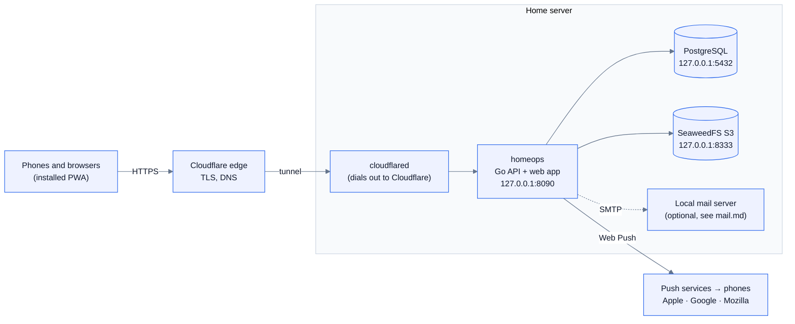
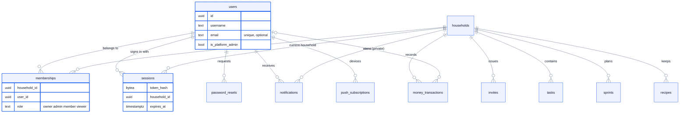
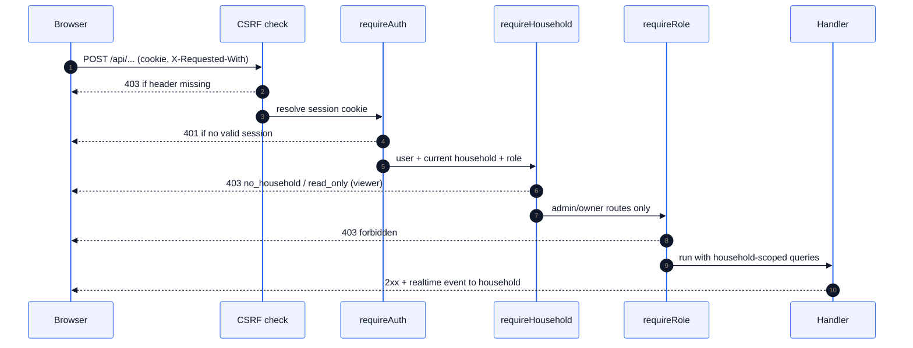

# Architecture



Nothing listens on a public port. Cloudflare Tunnel is an outbound connection from
the server, so the router has no port forwards. See [security.md](security.md).

## Components

| Part | Technology | Notes |
| --- | --- | --- |
| API + scheduler | Go, chi, pgx v5 | One static binary (`backend/cmd/homeops`). It also serves the built web app |
| Database | PostgreSQL | Embedded migrations in `backend/internal/store/migrations`, applied on every start |
| Files | SeaweedFS (S3 API) via minio-go, or a local directory | `internal/blob`. Files are served only through the app, behind sign-in |
| Web app | React 19, Vite, TanStack Query, Tailwind v4, Radix, dnd-kit, cmdk | `frontend/` |
| Offline | Workbox service worker (injectManifest) + IndexedDB-persisted query cache | Queued mutations replay on reconnect |
| Realtime | Server-Sent Events | One stream per open app. Works through Cloudflare (20 s keep-alives) |
| Push | Web Push with VAPID (webpush-go) | Keys generated on first start and stored in the DB |
| Auth | argon2id passwords, WebAuthn passkeys (go-webauthn), cookie sessions | 90-day sliding sessions |
| Parsers | `internal/statement` (bank statements), `internal/invoice` (Zepto/Blinkit PDFs) | Pure Go, fully tested against anonymised fixtures |

## Repository layout

```
backend/
  cmd/homeops       the server
  cmd/devdb         embedded Postgres for local development
  cmd/mailbridge    Cloudflare Email Worker → local SMTP bridge (see mail.md)
  cmd/invdump       debugging aid: dumps the words read from an invoice PDF
  internal/api      HTTP handlers, scheduler, push delivery, importers
  internal/store    connection pool + migrations
  internal/blob     file storage (S3 or directory)
  internal/mail     SMTP sender for invites and password resets
  internal/statement, internal/invoice   import parsers
frontend/src
  features/…        one folder per screen (tasks, meals, money, retro, settings, admin…)
  lib/…             API client, query cache, realtime, push, session, types
  sw.ts             service worker
infra/native        systemd deployment, hardening, mail (the recommended setup)
infra/, Dockerfile, docker-compose.yml   the Docker alternative
docs/               these documents
```

## Data model



Every piece of household data has a `household_id`, and every query filters by
the household of the current session.

- **users**: one row per person: username, optional unique email (case-insensitive),
  password hash, colour, notification preferences, quiet hours, `is_platform_admin`,
  and `last_household_id`.
- **households**: name, time zone, sprint cadence, planning time, meal times.
- **memberships** (`household_id`, `user_id`, `role`): role is `owner`, `admin`,
  `member` or `viewer`. The **members** view joins memberships with users, so
  household-scoped queries read like a plain table.
- **sessions**: hashed token, user, and the **household this session is in**. If
  the person is removed from that household, the next request falls back to another
  membership automatically.
- **invites**: code, household, email, role and expiry. Once used, `used_at` and
  `used_by` record who accepted.
- **password_resets**: hashed token, 1-hour expiry, single use.
- **notifications**: per user *and* household, plus a dedupe key that makes
  scheduled jobs idempotent. They double as the push outbox (`push_state`).
- **push_subscriptions**: one per browser, with delivery diagnostics
  (`last_success_at`, `failure_count`, `last_error`).
- Domain tables: tasks, sprints, recurring_tasks, labels, recipes, ingredients,
  meal_plan_items, grocery_items, pantry_items, money_* (categories, accounts,
  transactions, rules, imports, bills), retros, retro_cards, retro_votes, kudos.
- **Private money rows**: personal categories, accounts, transactions and bills
  carry `owner_id`. Every money query adds the condition
  `owner_id IS NULL OR owner_id = <me>`.

## Request flow and authorisation



1. `requireCSRFHeader`: every non-GET request must carry `X-Requested-With: homeops`.
   Browsers can't add that header cross-site without a CORS preflight, which is
   never approved.
2. `requireAuth` resolves the session cookie into the user, current household and role.
3. `requireHousehold` rejects people without a household (`no_household`) and
   rejects writes from viewers (`read_only`). The exceptions are marking
   notifications read and leaving the household.
4. `requireRole("admin" | "owner")` guards household settings, invites, member
   management and deletion. `platformAdminOnly` guards `/api/admin/*`.

Handlers then use `currentUser(r).HouseholdID` for every query. Login, invite and
reset endpoints are rate-limited per client IP (`CF-Connecting-IP`).

## Realtime and caching

Writes publish a topic (`tasks`, `meals`, `money`, `members`…) to the household's
SSE subscribers. Each client invalidates just those queries, and ignores its own
echoes by client ID. The query cache is persisted to IndexedDB, so the app renders
instantly with the last data. Switching household clears it and reloads, so data
from two households is never mixed.

## Background jobs

`runScheduler` ticks every minute per household, in its time zone:

- sprint auto-roll and recurring-chore generation;
- due digests (08:00 and 19:00) and ceremony reminders;
- meal-prep and pantry "use soon" notices;
- bill and budget alerts;
- session and old-notification cleanup.

The push deliverer sends pending notifications, holds them during each person's
quiet hours, and drops push for anything older than 12 hours (it stays in the
inbox). Push links carry `?hh=<household>`, so tapping one opens the right household.

## Migrations

Files in `backend/internal/store/migrations` are applied in order inside a
transaction at startup and recorded in `schema_migrations`. Never edit an applied
migration; add a new one. `0006_households_rbac.sql` shows how existing data is
converted in place (one household per user becomes memberships, and the setup user
becomes owner and platform administrator).
