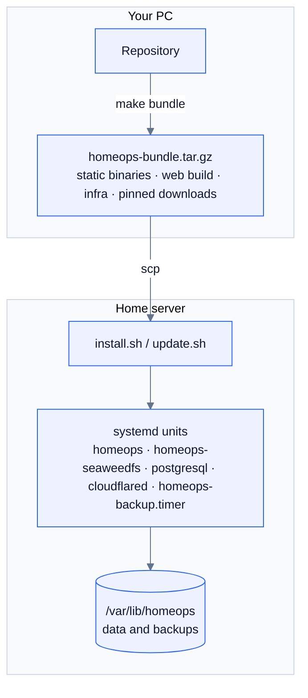

# Deployment

The recommended setup runs HomeOps natively on an Ubuntu/Debian home server with
systemd, published through a **Cloudflare Tunnel**: no open router ports and no
Docker. A [Docker Compose alternative](#docker-alternative) is described at the end.

- [What gets installed](#what-gets-installed)
- [1. Cloudflare Tunnel](#1-cloudflare-tunnel)
- [2. Build the bundle](#2-build-the-bundle-on-your-pc)
- [3. Install on the server](#3-install-on-the-server)
- [4. First sign-in and phones](#4-first-sign-in-and-phones)
- [Updating](#updating)
- [Configuration reference](#configuration-reference)
- [Cloudflare settings](#cloudflare-settings)

## What gets installed



| Path | Contents |
| --- | --- |
| `/opt/homeops` | `homeops` binary, `web/` (built app), `weed` (SeaweedFS), `backup.sh` |
| `/etc/homeops/homeops.env` | App configuration (root:homeops, 0640) |
| `/etc/homeops/s3.json` | SeaweedFS credentials |
| `/var/lib/homeops` | `seaweed/` (or `files/` with `--storage disk`), `backups/` |

| systemd unit | Purpose |
| --- | --- |
| `homeops.service` | The app on `127.0.0.1:<port>` (sandboxed: read-only system, private /tmp) |
| `homeops-seaweedfs.service` | Object storage on 127.0.0.1 (S3 8333; internal 9333/8381/8889) |
| `postgresql.service` | Distro PostgreSQL, database `homeops` |
| `homeops-backup.timer` | Nightly database + files backup, kept 30 days |
| `cloudflared.service` | The tunnel (unless `--no-tunnel`) |

Downloads (SeaweedFS, cloudflared) are pinned versions with SHA-256 checks.

## 1. Cloudflare Tunnel

1. Cloudflare dashboard → **Zero Trust → Networks → Tunnels → Create a tunnel** →
   *Cloudflared*, and name it `homeops`.
2. On *Install connector*, copy the token (the long string after `--token`).
3. **Public hostname**: e.g. `homeops.example.com` → service **HTTP**
   `localhost:8090`. The port is the one you pass to `install.sh --port`.

## 2. Build the bundle on your PC

The server needs neither Go nor Node; you build a self-contained bundle:

```sh
make bundle        # → .local/homeops-bundle.tar.gz (app, web build, infra scripts, pinned downloads)
scp .local/homeops-bundle.tar.gz server:/tmp/
```

Requires Go 1.27+ and Node 24+ on the PC.

## 3. Install on the server

```sh
tar xzf /tmp/homeops-bundle.tar.gz -C ~ && cd ~/homeops
cp .env.example .env && nano .env      # see below
sudo ./infra/native/install.sh --prebuilt --port 8090
```

`.env` needs:

| Variable | Value |
| --- | --- |
| `HOMEOPS_PUBLIC_URL` | Exactly the address people open, e.g. `https://homeops.example.com`. Passkeys and push are bound to it |
| `HOMEOPS_VAPID_EMAIL` | A contact address for push services |
| `POSTGRES_PASSWORD` | `openssl rand -base64 24` |
| `S3_ACCESS_KEY`, `S3_SECRET_KEY` | `openssl rand -hex 20` each |
| `TUNNEL_TOKEN` | From step 1 (omit with `--no-tunnel` if cloudflared is set up separately) |

Options: `--storage disk` skips SeaweedFS (uploads go to `/var/lib/homeops/files`),
and `--no-tunnel` skips cloudflared. The script is safe to re-run; data is kept.

Then harden the server: see [security.md](security.md).

## 4. First sign-in and phones

Open the public URL straight away and complete **Set up HomeOps**. The first account
becomes platform administrator and owner; after that, setup is closed for good.
Invite everyone else from **Settings → Members**. To install the app and enable
notifications on phones, see the [user guide](user-guide.md#phones-and-notifications).

## Updating

```sh
make bundle && scp .local/homeops-bundle.tar.gz server:/tmp/        # on the PC
cp ~/homeops/.env /tmp/homeops.env.keep                              # on the server
tar xzf /tmp/homeops-bundle.tar.gz -C ~ && cp /tmp/homeops.env.keep ~/homeops/.env
sudo ~/homeops/infra/native/update.sh --prebuilt
```

`update.sh` installs the new binary and web app, refreshes the units and restarts.
Database migrations run automatically on start. Before an update that includes a
migration:

1. Take a backup first: `sudo systemctl start homeops-backup`.
2. For a large change, rehearse it on a copy (see
   [operations.md](operations.md#rehearsing-a-migration)).

Open apps pick up the new version through the "A new version is ready" prompt.

## Configuration reference

`/etc/homeops/homeops.env` (written by `install.sh`; edit and `sudo systemctl restart homeops`):

| Variable | Default | Meaning |
| --- | --- | --- |
| `HOMEOPS_ADDR` | `:8080` | Listen address (install uses `127.0.0.1:<port>`) |
| `DATABASE_URL` | local `homeops` DB | Postgres connection string |
| `HOMEOPS_PUBLIC_URL` | `http://localhost:5173` | Public origin: WebAuthn RP ID, push, links in emails |
| `HOMEOPS_STATIC_DIR` | (none) | Built web app to serve (`/opt/homeops/web`) |
| `HOMEOPS_DATA_DIR` | `./data` | File storage when no S3 endpoint is set |
| `HOMEOPS_S3_ENDPOINT` | (none) | `host:port` of SeaweedFS; empty means use `HOMEOPS_DATA_DIR` |
| `HOMEOPS_S3_BUCKET` | `homeops` | Bucket name |
| `HOMEOPS_S3_ACCESS_KEY` / `HOMEOPS_S3_SECRET_KEY` | (none) | S3 credentials |
| `HOMEOPS_S3_USE_SSL` | off | `1` for TLS to the S3 endpoint |
| `HOMEOPS_VAPID_EMAIL` | `admin@localhost` | Push contact address |
| `HOMEOPS_SMTP_HOST` | (none) | SMTP server for invites and resets; empty means emails are only logged |
| `HOMEOPS_SMTP_PORT` | `587` | `465` = implicit TLS, otherwise STARTTLS when offered |
| `HOMEOPS_SMTP_USER` / `HOMEOPS_SMTP_PASSWORD` | (none) | SMTP login |
| `HOMEOPS_MAIL_FROM` | `HomeOps <no-reply@localhost>` | Sender of emails |
| `HOMEOPS_DEV` | off | `1` allows non-HTTPS cookies (local testing only) |

Without SMTP, invites still work: the invite screen shows the link to send yourself.
Password-reset emails need SMTP. [mail.md](mail.md) sets up a local mail server.

## Cloudflare settings

- **Don't** enable Rocket Loader or Email Obfuscation for the HomeOps hostname
  (they rewrite pages).
- Leave caching at defaults. The app sends correct `Cache-Control` headers:
  `sw.js` and `index.html` are never cached, and hashed assets are cached forever.
- If you put **Cloudflare Access** in front, add a *Bypass* policy for `/sw.js`,
  `/manifest.webmanifest` and `/api/*`. Otherwise service-worker updates and push
  re-subscription fail when the Access session expires. The app has its own login
  with rate limiting, so Access is optional for HomeOps.

## Docker alternative

For a machine where Docker is acceptable:

```sh
curl -fsSL https://get.docker.com | sudo sh && sudo usermod -aG docker $USER   # once
cp .env.example .env && nano .env      # same variables as above
make up                                # docker compose up -d --build
```

In the tunnel, point the public hostname at `http://app:8080`, since cloudflared
runs inside the compose network. Day-to-day: `make update`, `make logs` and
`make backup-now`. Backups land in `./backups`, and `./infra/restore.sh <file>`
restores the database.
