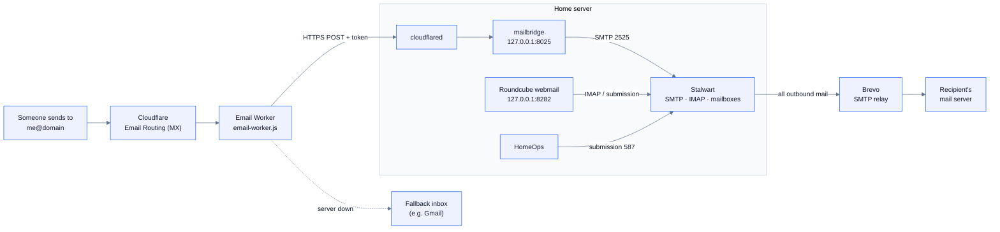

# Mail

Self-hosted mail for your domain (`me@yourdomain`, webmail, and HomeOps invite and
password-reset emails) without opening port 25 or revealing the home IP.

> **Status on this server:** installed and running inside the server (local
> delivery, webmail, IMAP), but **paused**: internet mail isn't flowing yet. To
> finish, see [Remaining setup](#remaining-setup). Meanwhile HomeOps doesn't send
> email; invite screens show the link to copy instead.

## How it works

Residential connections can't run a normal mail server. Inbound port 25 is usually
blocked and exposes the home IP. Outbound mail from home IPs is rejected as spam:
the address is on Spamhaus's residential list and has no matching reverse DNS. So
Cloudflare receives the mail and Brevo sends it.



| Piece | What it does |
| --- | --- |
| **Stalwart** 0.16 | Mailboxes, IMAP, SMTP, spam filter and DKIM signing. Settings live in its database, set declaratively by `plan.py` → `stalwart-cli apply` |
| **mailbridge** (`backend/cmd/mailbridge`) | Accepts the raw message from the worker (bearer token) and delivers it over SMTP. 200 = delivered, 422 = rejected for good (the worker bounces it), 503 = try later (the worker forwards to the fallback) |
| **Email Worker** | Streams each message to the bridge. Free Workers plan |
| **Roundcube** 1.7 (upstream, pinned) | Webmail. Ubuntu's 1.6 package breaks on PHP 8.5 and lags security fixes |
| **Brevo** | Outbound relay; its domain authentication makes mail pass SPF, DKIM and DMARC |

The bridge listener counts as a "port 25" connection for spam checks. DKIM, DMARC
and ARC are verified in relaxed mode (scored, never rejected). SPF and reverse-IP
checks are skipped, because bridged mail always connects from 127.0.0.1. Relaying
to other domains always requires signing in, and loopback is exempt from
Stalwart's auto-ban so a flood of bad attempts can't cut off local mail.

## Install

```sh
sudo ~/homeops/infra/native/mail/install-mail.sh --domain example.com
```

The script is idempotent. Re-run it after changing `/etc/homeops/mail.env`. It creates:

| What | Where |
| --- | --- |
| Mailbox `me@` with aliases postmaster, abuse, dmarc and hostmaster; sender account `no-reply@` | Stalwart |
| Secrets: admin, mailbox and sender passwords, bridge token, Brevo login and key | `/etc/homeops/mail.env` (root only) |
| Units | `stalwart`, `homeops-mailbridge`, `nginx`, `php*-fpm`, `mail-backup.timer` |

Read a secret with, for example, `sudo grep PASS_me /etc/homeops/mail.env`.

## Remaining setup

1. **Tunnel hostnames** (same tunnel as HomeOps):
   - `mail.<domain>` → `http://localhost:8282`
   - `mailin.<domain>` → `http://localhost:8025`
2. **Email Routing:** enable it for the domain (it adds MX and SPF records). Add your
   Gmail as a *verified destination address*, for the fallback.
3. **Email Worker:** create it, using either option:
   - **Dashboard:** Workers & Pages → Create → *Start with Hello World* → Deploy →
     *Edit code*, paste `infra/native/mail/email-worker.js`, Deploy. Then add these
     under *Settings → Variables and Secrets*, and **deploy again**:
     - `BRIDGE_URL` = `https://mailin.<domain>/inbound`
     - `FALLBACK_TO` = your verified address
     - secret `BRIDGE_TOKEN` = the `MAILBRIDGE_TOKEN` value
   - **CLI:** `npx wrangler@4.148.0 login`, then `./infra/native/mail/deploy-worker.sh`.
     It copies the token from the server without showing it.
4. **Routing rule:** *Catch-all → Send to a Worker*, and make sure the rule is **enabled**.
5. **Brevo:**
   - Create a free account and add the domain under *Senders & Domains*. Publish
     the records Brevo shows.
   - Create an *SMTP key*.
   - Put `BREVO_LOGIN` and `BREVO_SMTP_KEY` into `/etc/homeops/mail.env` and
     re-run `install-mail.sh`. HomeOps then starts sending invites and resets as
     `no-reply@<domain>`.
6. **DNS:**
   - Run `sudo ~/homeops/infra/native/mail/dns-records.sh` and add Stalwart's DKIM TXT records.
   - Set SPF to `v=spf1 include:_spf.mx.cloudflare.net include:spf.brevo.com ~all`.
   - Add DMARC on `_dmarc`: `v=DMARC1; p=quarantine; adkim=r; aspf=r; rua=mailto:dmarc@<domain>`.
7. **Recommended:** put Cloudflare Access in front of `mail.<domain>`, limited to your
   household's emails.

## Using it

- **Webmail:** `https://mail.<domain>`. Sign in as `me` (the domain is added for you).
- **Mail apps** on the LAN or ZeroTier, with server `<server IP>` and username `me@<domain>`:
  - IMAP: port 993, SSL
  - SMTP: port 587, STARTTLS

  The certificate is self-signed; accept it once.
- **Admin console:** `ssh -L 8480:127.0.0.1:8480 server`, then open
  http://localhost:8480/admin as `admin@<domain>` (password `STALWART_ADMIN_PASS`).

## Troubleshooting

| Symptom | Check |
| --- | --- |
| Mail from Gmail never arrives, and the bridge log is silent | Cloudflare → Email Routing → **Activity log** for the message's status. Check the catch-all rule is enabled and routed to the worker. Check the worker's variables, and that it was redeployed after adding them |
| Bridge log shows `unauthorized request` | The worker's `BRIDGE_TOKEN` doesn't match `MAILBRIDGE_TOKEN` |
| Messages land in Junk | Normal for unsigned test mail. Real mail is DKIM-signed and scores as ham. Check the `X-Spam-Result` header |
| Outbound mail stuck | Brevo not configured yet. Then: `journalctl -u stalwart \| grep -i delivery` |
| Webmail 500 | `sudo tail /var/log/nginx/error.log` |

Logs: `journalctl -u homeops-mailbridge -u stalwart -f`.
