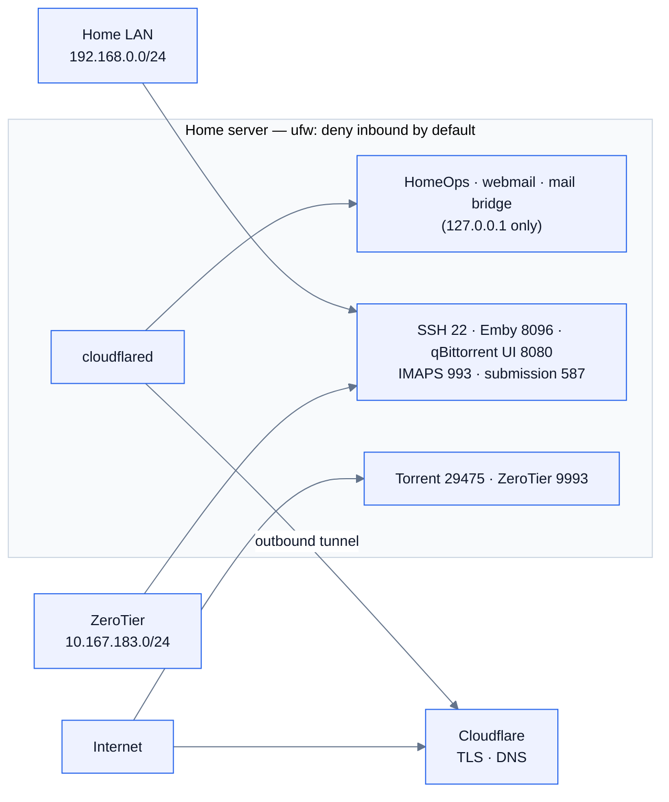

# Security

How the home server and HomeOps are protected, and how to keep them that way.

- [Exposure](#exposure)
- [Hardening script](#hardening-script)
- [homeguard watchdog](#homeguard-watchdog)
- [SSH access](#ssh-access)
- [Application security](#application-security)
- [Secrets](#secrets)
- [Checklist](#checklist)

## Exposure

The router forwards no ports. The public sites reach the server only through the
Cloudflare Tunnel, which the server opens *outbound*. The firewall (ufw) drops
everything inbound except from your own networks.



| Reachable from | Services |
| --- | --- |
| Internet, via Cloudflare | HomeOps, webmail, mail bridge (token required). Nothing else |
| Internet, directly | Torrent peer port 29475 and ZeroTier 9993/udp only |
| LAN + ZeroTier | SSH, Emby, qBittorrent web UI, mail clients (IMAPS 993, submission 587) |
| Nowhere outside the machine | PostgreSQL, SeaweedFS, Stalwart admin (8480), internal SMTP |

The server also has a public IPv6 address. The firewall covers IPv6 too, so
nothing is reachable through it except the two ports above.

## Hardening script

```sh
sudo ~/homeops/infra/native/security/harden.sh            # trusted nets default to the LAN + ZeroTier above
sudo ~/homeops/infra/native/security/harden.sh --trusted "192.168.1.0/24 10.147.17.0/24"
```

It's idempotent and does the following:

- **Firewall:** ufw denies inbound, allows outbound, and opens the ports in the table
  above only to the trusted networks. It comes up with a **5-minute automatic
  rollback**. Confirm you can still open a *new* SSH session, then run
  `sudo systemctl stop ufw-rollback.timer`.
- **SSH:** keys only, no root login, 3 attempts per connection. It refuses to run if
  your user has no authorised key, so it can't lock you out.
- **fail2ban** bans IPs that keep failing SSH logins (1 hour, growing on repeats).
- **Kernel:** ignores spoofed and redirected packets, uses SYN cookies, and restricts
  kernel pointers, dmesg, ptrace and unprivileged BPF.
- **`/dev/shm` noexec:** a favourite place for miners to drop and run binaries.
- **Automatic security updates** (unattended-upgrades).

The HomeOps, SeaweedFS, mail and bridge services also run sandboxed by systemd:
read-only system, private `/tmp`, no new privileges, no capabilities beyond what
they need, and memory caps.

## homeguard watchdog

`homeguard` runs every 10 minutes (`homeguard.timer`) and alerts on:

- **crypto miners**: known miner names and pool URLs (`stratum+tcp`, xmrig, kinsing…);
- **programs whose file was deleted** after starting (a common way to hide);
- **sustained CPU**: any process over 70% of a core for two checks in a row,
  except an allowlist (Emby transcoding, qBittorrent, Postgres, HomeOps…);
- **executables in `/tmp`, `/var/tmp`, `/dev/shm`**;
- **changes** compared with the last check: listening ports, users with a shell or
  uid 0, SSH authorised keys, sudoers, cron jobs, systemd units and setuid binaries.

Alerts go to the journal and, when `/etc/homeguard.conf` has SMTP settings, by email.

```sh
sudo journalctl -t homeguard            # what it has reported
sudo homeguard                          # run a check now
sudo homeguard --rebaseline             # after a deliberate change (new service, new key…)
sudo homeguard --test                   # send a test alert
```

Add busy-but-legitimate programs with `CPU_ALLOW="$CPU_ALLOW user:command"` in
`/etc/homeguard.conf`.

## SSH access

Password login is off. To allow a new device, add its public key from a device that
already has access:

```sh
# on the new device (once):  ssh-keygen -t ed25519
# then from a device that can already log in:
cat new_device.pub | ssh sayan@server 'cat >> ~/.ssh/authorized_keys'
sudo homeguard --rebaseline               # on the server, so the new key isn't reported
```

If every key is lost, use the server's own keyboard and screen. Or temporarily set
`PasswordAuthentication yes` in `/etc/ssh/sshd_config.d/10-homeops-hardening.conf`.

## Application security

- **Sign-in:** argon2id password hashes and WebAuthn passkeys. Sessions are random
  tokens, stored hashed, in an HttpOnly, Secure, SameSite=Lax cookie.
- **Brute force:** login, invite and reset endpoints are rate-limited per client IP
  (Cloudflare's `CF-Connecting-IP`). Password reset doesn't reveal whether an email
  has an account.
- **CSRF:** all writes need the `X-Requested-With: homeops` header, which other sites
  can't send.
- **Isolation:**
  - Every query is scoped to the session's household, and roles are checked on the
    server.
  - Viewers are read-only, enforced on the server.
  - Private budget data is filtered by owner in every query.
  - The platform administrator can't read households they aren't in.
- **Invites** are single-use, expire after 7 days and only work for the invited
  email. They never downgrade someone's existing role.
- **Recipe import** refuses to fetch private, loopback and link-local addresses
  (protection against SSRF).
- **Files** (photos, receipts, PDFs) are served only through the app, after sign-in.
- **Webmail** runs upstream Roundcube under PHP `open_basedir`. Its config, installer
  and vendor paths are blocked. For an extra layer, put Cloudflare Access in front of
  `mail.<domain>`.

## Secrets

| Secret | Where | Rotate by |
| --- | --- | --- |
| Database, S3 and VAPID settings | `/etc/homeops/homeops.env`, `/etc/homeops/s3.json` (root:homeops 0640) | Edit and restart; VAPID keys are in the DB (rotating them means everyone re-enables push) |
| Tunnel token | cloudflared service | Cloudflare dashboard → tunnel → refresh token, then `sudo cloudflared service install <new token>` |
| Mail passwords, bridge token, Brevo key | `/etc/homeops/mail.env` (root 0600) | Edit and re-run `install-mail.sh` (update the worker's `BRIDGE_TOKEN` too) |
| Gemini API key | `/etc/homeops/ai.env` (root 0600) | Make a new key in Google AI Studio, `sudoedit /etc/homeops/ai.env`, restart `homeops`, delete the old key |

Nothing secret is in the repository: `.env`, `.local/` and `backend/.devdata/`
are git-ignored. Real bank statements and invoices are never committed, and the
test fixtures are anonymised.

## Checklist

- [ ] Change the server account password (`passwd`). It's what `sudo` asks for.
- [ ] Refresh the Cloudflare Tunnel token if it was ever shared.
- [ ] Copy `/var/lib/homeops/backups` off the server regularly.
- [ ] Glance at `sudo journalctl -t homeguard` now and then, or set up email alerts.
- [ ] Keep upstream pins current: Roundcube (`ROUNDCUBE_VERSION` in
      `infra/native/mail/install-mail.sh`), Stalwart, SeaweedFS and cloudflared.
